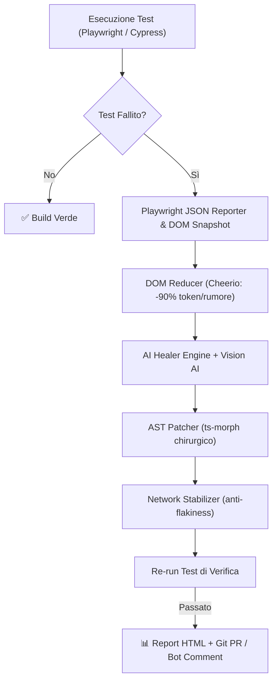

# 🛡️ AutoHeal Agent v2.0

> **Autonomous Testing & Regression Agent (Self-Healing Tests for Playwright, Cypress, Testing Library)**
> Ripara automaticamente test E2E e unitari rotti, analizza il DOM semantico, usa Computer Vision multimodale, stabilizza test flaky e apre Pull Request automatiche.

---

## 👤 Autore
**Franca Roscilli**
- GitHub: [@francaroscillidev-gif](https://github.com/francaroscillidev-gif)
- Email: francaroscillidev@gmail.com
- Licenza: **Apache License 2.0**

---

## 🚀 Nuove Funzionalità di AutoHeal v2.0

1. **Self-Healing AST Chirurgico (`autoheal run`)**:
   - Sostituisce i locator rotti con le best practice semantiche (`getByRole`, `getByTestId`, `getByPlaceholder`).
2. **Interactive HTML Dashboard (`autoheal-report.html`)**:
   - Resoconto visivo con tasso di riparazione %, diff colorato prima/dopo e spiegazione AI.
3. **Generatore di Test Zero-to-One (`autoheal generate <url/file>`)**:
   - Genera suite di test Playwright pronte all'uso analizzando la struttura della pagina.
4. **Flaky Test Eliminator & Network Stabilizer (`autoheal stabilize <file>`)**:
   - Rileva ed elimina race condition, chiamate API asincrone instabili e genera stub di rete (`page.route`).
5. **Multimodal Vision Healer (`autoheal vision <screenshot>`)**:
   - Analizza visivamente la UI tramite Computer Vision / Gemini Vision AI se il DOM è mutato radicalmente.
6. **Supporto Cross-Framework**:
   - Playwright, Cypress (`cy.get` ➔ `cy.findByRole`), e React Testing Library (`screen.getByRole`).
7. **GitHub Action Bot Integration (`src/git/botCommenter.ts`)**:
   - Pubblica commenti interattivi nelle Pull Request con il report e il comando `/autoheal apply`.

---

## 🏛️ Architettura del Sistema



---

## ⚡ Comandi CLI

```bash
# 1. Esegui la suite con auto-healing
npx autoheal run

# 2. Genera un nuovo test da zero analizzando un file HTML o URL
npx autoheal generate demo/app.html --output demo/auto-generated.spec.ts

# 3. Stabilizza un test flaky da race-conditions asincrone
npx autoheal stabilize demo/checkout.spec.ts

# 4. Analisi visiva di uno screenshot con Vision AI
npx autoheal vision demo/error-screenshot.png --desc "Bottone Paga Ora"
```

---

## 📄 Licenza

Rilasciato sotto licenza Apache 2.0. Consulta il file [LICENSE](LICENSE) per i dettagli.
