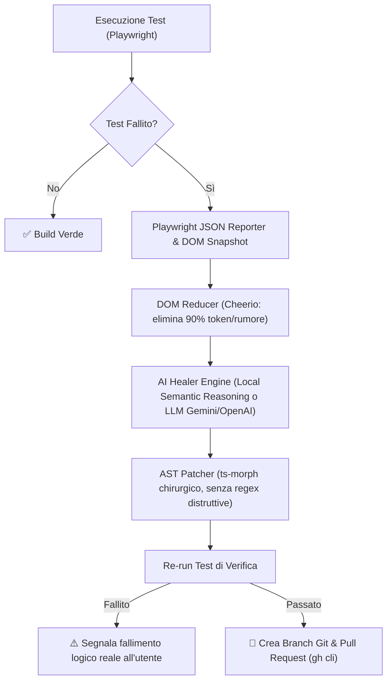

# 🛡️ AutoHeal Agent

> **Autonomous Testing & Regression Agent (Self-Healing Tests)**
> Ripara automaticamente test E2E rotti (Playwright), analizza il DOM semantico, capisce l'intento originale e crea Pull Request automatiche.

---

## 🚀 Perché è Rivoluzionario

La manutenzione dei test end-to-end (Playwright, Cypress) è una delle attività più costose e noiose nel ciclo di sviluppo software:
- Uno sviluppatore frontend cambia una classe CSS (`.btn-old` -> `.btn-primary-2026`) o ristruttura un form.
- I test di regressione falliscono in CI bloccando il deploy.
- **AutoHeal Agent interviene prima o durante la CI**: analizza l'intento originale del test, esamina il nuovo DOM compresso, genera il locator Playwright moderno raccomandato (`getByRole`, `getByTestId`, `getByLabel`), patcha il codice sorgente tramite AST e apre la PR con la fix.

---

## 🏛️ Architettura del Sistema



---

## 📂 Struttura del Progetto

```
autoheal/
├── src/
│   ├── cli.ts                 # CLI principale (autoheal run, autoheal heal)
│   ├── ai/
│   │   └── healer.ts          # Engine di riparazione (Gemini API + Local Semantic Reasoning)
│   ├── dom/
│   │   └── reducer.ts         # Minimizzatore DOM semantico ad alta efficienza
│   ├── patcher/
│   │   └── astPatcher.ts      # Patching chirurgico del codice sorgente via AST (ts-morph)
│   ├── runner/
│   │   └── testRunner.ts      # Runner e analizzatore Playwright con JSON reporter
│   └── git/
│       └── prGenerator.ts     # Generatore automatico di branch e Pull Request GitHub
├── demo/
│   ├── app.html               # Pagina di checkout d'esempio con redesign UI
│   └── checkout.spec.ts       # Test Playwright fragile
├── playwright.config.ts       # Configurazione Playwright
├── package.json
└── tsconfig.json
```

---

## ⚡ Come Provarlo (Demo End-to-End)

1. Entra nella cartella:
   ```bash
   cd autoheal
   ```

2. Esegui la suite con auto-healing integrato:
   ```bash
   npm run autoheal:demo
   ```

3. **Cosa succede:**
   - Il test fallisce perché cercava `page.locator('.old-btn-submit')` (rimosso nel redesign).
   - L'agente analizza il DOM, riconosce l'intento dell'azione sul bottone *"Paga Ora"*.
   - Riconosce l'elemento semantico `data-testid="checkout-submit"`.
   - Modifica `demo/checkout.spec.ts` sostituendolo con `page.getByTestId('checkout-submit')`.
   - Ri-esegue il test che diventa **VERDE**.

---

## 🤖 Configurazione LLM (Opzionale)

L'agente include un **Local Semantic Intent Matcher** che funziona offline al 100% senza alcuna chiave API. Se vuoi abilitare il ragionamento avanzato tramite LLM su DOM complessi:

```bash
export GEMINI_API_KEY="tua-chiave-gemini"
# oppure
export OPENAI_API_KEY="tua-chiave-openai"
```

---

## 🔄 Integrazione GitHub Actions (CI/CD)

Aggiungi `.github/workflows/autoheal.yml`:

```yaml
name: Playwright Tests & AutoHeal
on: [push, pull_request]

jobs:
  test-and-heal:
    runs-on: ubuntu-latest
    steps:
      - uses: actions/checkout@v4
      - uses: actions/setup-node@v4
        with:
          node-version: 22
      - run: npm ci
      - run: npx playwright install --with-deps
      
      - name: Run Test with AutoHeal Agent
        env:
          GITHUB_TOKEN: ${{ secrets.GITHUB_TOKEN }}
        run: |
          npx autoheal run
```

---

## 👤 Autore

**Franca Roscilli**
- GitHub: [@francaroscillidev-gif](https://github.com/francaroscillidev-gif)
- Email: francaroscillidev@gmail.com

---

## 📄 Licenza

Rilasciato sotto licenza MIT.

