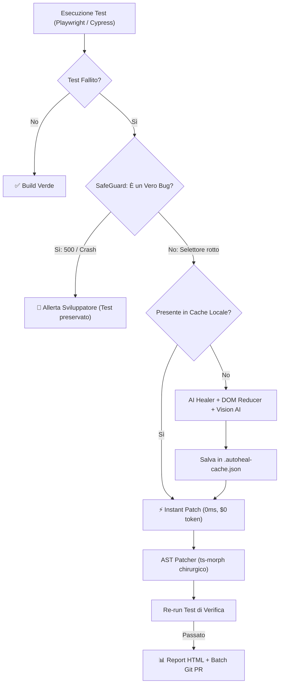

# 🛡️ AutoHeal Agent v3.0

> **Enterprise Autonomous Testing & Regression Agent (Self-Healing Tests for Playwright, Cypress, Testing Library)**
> Ripara automaticamente test E2E e unitari rotti, memorizza le soluzioni in cache a 0ms, usa SafeGuard contro i falsi positivi, supporta il Live TDD Watcher e crea Batch Pull Request raggruppate.

---

## 👤 Autore
**Franca Roscilli**
- GitHub: [@francaroscillidev-gif](https://github.com/francaroscillidev-gif)
- Email: francaroscillidev@gmail.com
- Licenza: **Apache License 2.0**

---

## 🚀 Novità Principali di AutoHeal v3.0

1. **⚡ Persistent Memory Cache (`.autoheal-cache.json`)**:
   - Una volta che un selettore viene riparato, la soluzione viene memorizzata in locale. Le esecuzioni successive applicano la fix in **0 millisecondi** a **$0 token** (`⚡ [Cache Hit]`).
2. **🛡️ SafeGuard Mode (True Bug Detector)**:
   - Distingue automaticamente i veri bug (errori HTTP 5xx del backend, eccezioni JavaScript non gestite o crash React) dai semplici cambi di selettore. Se è un vero bug dell'applicazione, **NON** altera il test e allerta lo sviluppatore.
3. **👀 Live TDD Watcher (`autoheal watch`)**:
   - Monitora i file dell'applicazione mentre sviluppi: se modifichi un componente o una form, ri-esegue e ripara automaticamente i test in background in tempo reale.
4. **📦 Grouped Batch Pull Request (`BatchPrGenerator`)**:
   - Raggruppa tutti i test riparati della suite in un'unica Pull Request ordinata con changelog e tabella comparativa.
5. **👁️ Multimodal Vision AI (`autoheal vision <screenshot>`)**:
   - Riconosce visivamente bottoni ed elementi spostati tramite Computer Vision e Gemini Vision se il DOM è cambiato radicalmente.
6. **🧪 Test Suite Generator Zero-to-One (`autoheal generate <url/file>`)**:
   - Genera da zero suite di test Playwright resilienti con selettori raccomandati (`getByRole`, `getByTestId`).
7. **🌐 Supporto Cross-Framework**:
   - Playwright, Cypress e React Testing Library.

---

## 🏛️ Architettura del Sistema



---

## ⚡ Comandi CLI Principali

```bash
# 1. Esegui la suite con auto-healing, cache e report HTML
npx autoheal run

# 2. Avvia la modalità Live Watcher durante lo sviluppo
npx autoheal watch

# 3. Genera uno script di test da zero analizzando una pagina o URL
npx autoheal generate demo/app.html --output demo/auto-generated.spec.ts

# 4. Stabilizza test flaky e race conditions di rete
npx autoheal stabilize demo/checkout.spec.ts

# 5. Analisi visiva di uno screenshot con Vision AI
npx autoheal vision demo/error-screenshot.png --desc "Pulsante Paga Ora"
```

---

## 📄 Licenza

Rilasciato sotto licenza Apache 2.0. Consulta il file [LICENSE](LICENSE) per i dettagli.
