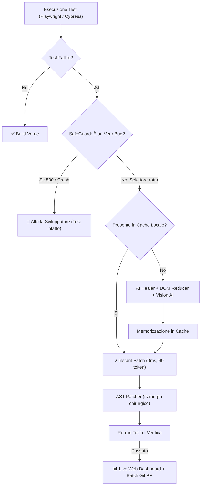

# 🛡️ AutoHeal Agent v5.0 Ultimate

<p align="center">
  
  
  
</p>

> **Enterprise Autonomous Testing & Regression Agent (Playwright, Cypress, Testing Library)**
> Ripara automaticamente test E2E e unitari rotti, offre una Live Web Dashboard, funge da server MCP per AI esterne, ottimizza le suite di test con Doctor CLI e apre Batch Pull Request raggruppate.

---

## 👤 Autore
**Franca Roscilli**
- GitHub: [@francaroscillidev-gif](https://github.com/francaroscillidev-gif)
- Email: francaroscillidev@gmail.com
- Licenza: **Apache License 2.0**

---

## 🚀 Nuove Funzionalità di AutoHeal v5.0 Ultimate

1. **🩺 Autonomous Health Check (`autoheal doctor`)**:
   - Diagnosi immediata dell'ambiente: verifica Node.js, browser Playwright, git e file di configurazione con rimedi one-click.
2. **⚡ Suite Deduplicator & Optimizer (`autoheal optimize`)**:
   - Analizza l'AST dei test, individua step e form fill ridondanti e stima i millisecondi risparmiati in CI.
3. **🌐 Interactive Web Dashboard (`autoheal serve`)**:
   - Web application su `http://localhost:4321` con ispezione cache e live DOM tester.
4. **🤖 Model Context Protocol (MCP) Server Ufficiale (`autoheal mcp`)**:
   - Standard JSON-RPC per consentire a Claude Desktop, Cursor e Antigravity di eseguire self-healing e diagnosi.
5. **⚡ Instant Memory Cache (`.autoheal-cache.json`)**:
   - Risolve istantaneamente i selettori noti a **0ms** e **$0 token** (`⚡ [Cache Hit]`).
6. **🛡️ SafeGuard Mode (Anti-False Positives)**:
   - Distingue i veri bug (HTTP 500, crash JavaScript) dai cambi di markup e protegge l'integrità dei test.
7. **👀 Live TDD Watcher (`autoheal watch`)**:
   - Monitora il codice durante lo sviluppo: quando modifichi un componente, ri-esegue e auto-ripara i test in background in tempo reale.
8. **👁️ Multimodal Vision Healer (`autoheal vision <screenshot>`)**:
   - Utilizza Gemini Vision AI per localizzare visivamente i controlli sullo schermo.
9. **🧪 Test Suite Generator (`autoheal generate <url/file>`)**:
   - Crea suite di test Playwright complete analizzando la struttura della pagina web.

---

## 🏛️ Architettura del Sistema



---

## ⚡ Guida ai Comandi CLI

```bash
# 1. Esegui la suite con auto-healing, SafeGuard e Cache istantanea
npx autoheal run

# 2. Diagnostica l'ambiente di lavoro con Doctor CLI
npx autoheal doctor

# 3. Ottimizza la suite eliminando passaggi ridondanti
npx autoheal optimize demo

# 4. Avvia la Dashboard Web Interattiva
npx autoheal serve --port 4321

# 5. Inizializza il file di configurazione autoheal.config.json
npx autoheal init

# 6. Avvia la modalità Live Watcher durante lo sviluppo
npx autoheal watch

# 7. Genera una nuova suite di test analizzando un file HTML o URL
npx autoheal generate demo/app.html --output demo/auto-generated.spec.ts

# 8. Avvia il server Model Context Protocol (MCP) per client AI
npx autoheal mcp

# 9. Rigenera i badge SVG ufficiali
npx autoheal badges
```

---

## 📄 Licenza

Rilasciato sotto licenza Apache 2.0. Consulta il file [LICENSE](LICENSE) per i dettagli.
