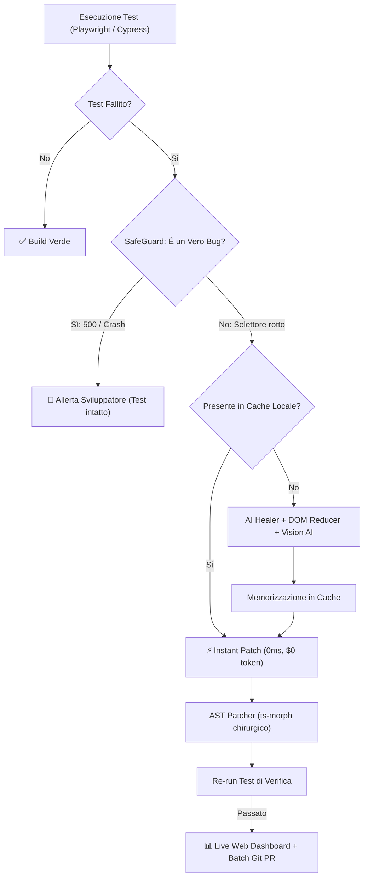

# 🛡️ AutoHeal Agent v4.0 Enterprise

> **Autonomous Testing & Regression Agent (Playwright, Cypress, Testing Library)**
> Ripara automaticamente test E2E e unitari rotti, offre una Live Web Dashboard, funge da server MCP per AI esterne, memorizza le soluzioni in cache a 0ms e apre Pull Request raggruppate.

---

## 👤 Autore
**Franca Roscilli**
- GitHub: [@francaroscillidev-gif](https://github.com/francaroscillidev-gif)
- Email: francaroscillidev@gmail.com
- Licenza: **Apache License 2.0**

---

## 🚀 Novità Principali di AutoHeal v4.0

1. **🌐 Interactive Web Dashboard (`autoheal serve`)**:
   - Avvia una dashboard web moderna su `http://localhost:4321` con metriche in tempo reale, esploratore della memoria cache e playground per testare il DOM reducer in diretta.
2. **🤖 Model Context Protocol (MCP) Server Ufficiale (`autoheal mcp`)**:
   - Permette a client AI come Claude Desktop, Cursor, Antigravity e Windsurf di diagnosticare e auto-riparare test via standard JSON-RPC.
3. **⚙️ Configurazione Centralizzata (`autoheal init`)**:
   - Gestione personalizzata tramite `autoheal.config.json` (soglie di confidenza, selettori ignorati, auto-commit).
4. **⚡ Persistent Memory Cache (`.autoheal-cache.json`)**:
   - Risolve istantaneamente i selettori noti a **0ms** e **$0 token** (`⚡ [Cache Hit]`).
5. **🛡️ SafeGuard Mode (Anti-False Positives)**:
   - Distingue i veri bug applicativi (HTTP 500, crash JavaScript, errori React) dai cambi di markup e protegge l'integrità del test suite.
6. **👀 Live TDD Watcher (`autoheal watch`)**:
   - Monitora il codice durante lo sviluppo: quando modifichi un componente, ri-esegue e auto-ripara i test in background in tempo reale.
7. **👁️ Multimodal Vision Healer (`autoheal vision <screenshot>`)**:
   - Utilizza Gemini Vision AI per localizzare visivamente i controlli sullo schermo.
8. **🧪 Test Suite Generator (`autoheal generate <url/file>`)**:
   - Crea suite di test Playwright complete analizzando la struttura della pagina web.

---

## 🏛️ Architettura del Sistema



---

## ⚡ Guida ai Comandi CLI

```bash
# 1. Esegui la suite con auto-healing, SafeGuard e Cache istantanea
npx autoheal run

# 2. Avvia la Dashboard Web Interattiva
npx autoheal serve --port 4321

# 3. Inizializza il file di configurazione autoheal.config.json
npx autoheal init

# 4. Avvia la modalità Live Watcher durante lo sviluppo
npx autoheal watch

# 5. Genera da zero una suite di test analizzando una pagina o URL
npx autoheal generate demo/app.html --output demo/auto-generated.spec.ts

# 6. Avvia il server Model Context Protocol (MCP) per client AI
npx autoheal mcp

# 7. Stabilizza test flaky soggetti a race conditions
npx autoheal stabilize demo/checkout.spec.ts

# 8. Analisi visiva di uno screenshot con Vision AI
npx autoheal vision demo/error-screenshot.png --desc "Pulsante Paga Ora"
```

---

## 📄 Licenza

Rilasciato sotto licenza Apache 2.0. Consulta il file [LICENSE](LICENSE) per i dettagli.
